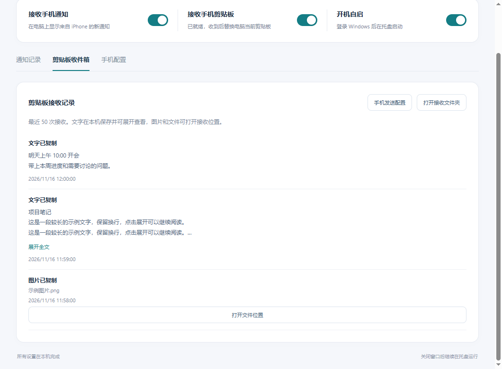

# 手机通知 · iPhone LAN Notify

通过局域网，把 iPhone 的新通知转发到 Windows。无需蓝牙，也无需 Phone Link。

电脑端提供独立桌面应用、托盘接收开关、登录自启、通知记录和紧凑消息卡片；手机端使用快捷指令的“收到通知”自动化与 Scriptable。所有配置和通知记录保存在本机，不使用云端中转。


## 功能

- 右下角 404 × 88 紧凑卡片，约 5 秒后收起，悬停暂停，长文字省略并可悬停查看。
- 左侧来源 App 图标，底部 `微信 • 来自 iPhone`。
- 同时存入 Windows 通知中心，抑制重复的系统横幅；通知中心只保留分组小图标。
- 点击卡片或通知中心消息，打开应用并定位、高亮对应记录；点击卡片会清除对应系统通知，应用记录保留。
- 最近 200 条通知在本机保留 7 天。
- 内置 30 个中国常用 App 图标，首次使用也无需联网查询；其他应用查询 App Store 并缓存，无法确定时使用默认图标。
- 接收开关、登录自启、网卡地址与端口设置均在桌面应用中完成。
- 独立的手机剪贴板接收开关：文字、图片和多文件发送后，可直接在 Windows 粘贴；文件同时保存在本机收件箱。
- 手机离线、电脑关闭或不在同一局域网时，Scriptable 捕获失败并静默跳过，不补发历史通知。

## 使用前确认

电脑目标环境为 **Windows 10/11 x64**，需要 .NET Framework 4.6.2 或更新版本（推荐 4.8）、WebView2 Runtime 和 Windows PowerShell 5.1。完整发行包包含 Node.js，用户无需单独安装 Node.js。

手机需有 **“收到某个 App 的通知”自动化触发器**，并安装 Scriptable。不同 iOS 版本、地区和系统权限可能影响可用性；先在手机快捷指令中确认该触发器存在。本项目已在开发者的 iPhone 通知自动化环境使用，不承诺所有 iOS 版本均可使用，也不绕过 iOS 限制。

手机和电脑必须实际互通：同名 Wi-Fi 不保证互通；访客网络、AP 隔离、VPN 和部分虚拟网卡可能阻断连接。此版本按 IPv4 地址配对，电脑地址变化后需更新手机脚本地址。建议在路由器给电脑配置 DHCP 地址保留。

## 在新电脑使用

可在仓库 Actions 中打开最近成功的 **Windows build**，下载 **PhoneNotify-win-x64** 构建产物，解压后取得程序 ZIP 和 SHA-256 校验文件；也可从源码运行下方构建命令生成 ZIP。不要求用户沿用开发者的目录、IP 或 Node.js 路径。

1. 解压完整的 `PhoneNotify-1.2.0-win-x64.zip`，不要只复制一个 EXE。
2. 在解压目录运行环境检查：

   ```powershell
   powershell -NoProfile -ExecutionPolicy Bypass -File .\check-environment.ps1
   ```

   缺少 WebView2 Runtime 时，可从 [Microsoft 官方页面](https://developer.microsoft.com/microsoft-edge/webview2/) 安装，或运行 `check-environment.ps1 -InstallWebView2`。脚本仅执行经过 Microsoft 数字签名验证的官方下载程序。

3. 双击 `PhoneNotify.exe` 直接使用；也可运行 `install.ps1` 安装到当前用户的 `%LOCALAPPDATA%\PhoneNotify\app` 并创建桌面入口。默认不需要管理员权限；防火墙配置另需管理员授权。
4. 首次启动会生成本机独立的配对令牌，默认关闭接收。进入“手机配置”，选择与手机相通的网卡地址，保存端口。
5. 点击“允许专用局域网访问”，按 Windows 提示授权；规则仅允许指定 Node.js 程序、TCP 端口、专用网络和本地子网。请自行确认当前 Windows 网络类型为“专用”，程序不会更改网络类型。
6. 打开“接收手机通知”，先点“发送测试通知”检查电脑端，再按下一节配置手机并测试真实通知。

开机自启开关表示“当前用户登录 Windows 后启动”，不是未登录时运行的系统服务。关闭窗口会隐藏到托盘；托盘菜单可彻底退出。

## 配置 iPhone

1. 安装 Scriptable。在电脑应用“手机配置”页复制或导出为当前电脑生成的发送脚本，传到手机，保存为 **通知静默转发**。
2. 在快捷指令中新建“收到所选 App 通知时”的自动化。可以参考应用内提供的 [快捷指令分享](https://www.icloud.com/shortcuts/f1cc45ac60934a4baa820400ed63fe2b)，导入后仍需确认通知触发器、应用选择和脚本参数；分享链接失效时按以下步骤手动建立。
3. 添加“文本”动作，内容放入触发器的蓝色“通知”变量；添加“字典”，建立文本字段：

   | 字段 | 值 |
   | --- | --- |
   | `message` | 前一个“文本”动作的输出 |
   | `appId` | 触发器“通知”变量的 `App` 属性 |

   若系统能提供软件包标识符，可传 Bundle ID；只能提供应用名称也可以。不要把普通文字“通知”当成蓝色变量。

4. 添加 Scriptable“运行脚本”，选择 **通知静默转发**，参数选择上一步的**字典**。若有“在 App 中运行”，关闭该选项；按系统提供的选项允许无需确认及锁定时运行，允许 Scriptable 访问本地网络。
5. 用一条**新收到的真实通知**测试，再锁屏测试。手动点击运行通常没有通知触发器输入，不能作为实际转发失败的依据。
6. 分别测试：同一局域网能收到；关闭手机 Wi-Fi 时不弹超时；重新连接后新的通知恢复接收。

电脑应用会生成含本机地址和令牌的完整脚本；源码模板位于 `scriptable/iphone-notify.template.js`。请勿把个人生成的脚本、配对地址或二维码公开上传。

## 图标匹配

优先使用精确 Bundle ID，其次使用内置目录的名称和明确别名；目录外的应用在线查询后，接受唯一完整名称或去掉 `-`、括号、冒号等宣传后缀后的唯一基础名称。不会直接选择搜索第一项，也不会通过“包含 QQ”把 QQ邮箱识别成 QQ。同名、名称不一致、商店未收录或网络失败时可能使用默认图标。

内置应用：微信、QQ、QQ邮箱、支付宝、京东金融、京东、淘宝、拼多多、闲鱼、美团、美团外卖、淘宝闪购（饿了么）、高德地图、百度地图、滴滴出行、铁路12306、携程旅行、抖音、快手、小红书、哔哩哔哩、腾讯视频、爱奇艺、网易云音乐、QQ音乐、钉钉、飞书、企业微信、百度网盘、菜鸟。X、币安保留在线查询及缓存支持。

内置清单见 `app-icon-catalog.json`。已有图标立即显示，过期时后台更新；未知应用最多等待图标约 2.2 秒，超时先用默认图标。通知自动化仅转发通知文字，不提取通知内的图片、附件或操作按钮；手动图片和文件发送见下面的独立功能。

## 发送手机剪贴板、图片和文件



电脑应用开启 **接收手机剪贴板** 后，在“剪贴板收件箱”页复制生成的脚本，在手机 Scriptable 新建 **发送到电脑** 并保存。此开关独立于通知开关；关闭通知后仍可接收剪贴板，两个开关都关闭时停止接收服务。

**复制后发送文字／图片：**

1. 扫描电脑应用“剪贴板收件箱”页的二维码，或打开 [发送剪切板到电脑快捷指令](https://www.icloud.com/shortcuts/154c82177e5a45c295d1c8419607f8ed) 导入。此链接分享快捷指令动作，Scriptable **发送到电脑** 脚本仍需按当前电脑的配置单独保存。分享失效时，可手动新建快捷指令，先添加 **获取剪贴板**，再添加 Scriptable 的“运行脚本”，选择 **发送到电脑**。
2. 检查“运行脚本”的 **参数为上一步蓝色的「剪贴板」变量**，并关闭 **“在 App 中运行”和“运行时显示 / Show When Run”两个开关**，避免每次运行需要点“完成”。由快捷指令读取文字或图片后传入脚本；首次需允许访问剪贴板和本地网络。不要把“剪贴板”三个字作为普通文字填写。参数留空时脚本仍会尝试直接读取，但部分运行环境可能返回空值，因此不作为推荐配置。
3. 将快捷指令添加到控制中心，或在 `设置 → 辅助功能 → 触控 → 轻点背面` 中绑定。
4. 手机复制内容，运行一次快捷指令，电脑按 Ctrl+V。不会常驻小窗，也不会在每次复制时自动发送。

**发送分享内容和文件：**

在 Scriptable 的脚本设置中启用分享表单（Share Sheet），允许 Text、URLs、Images、File URLs 输入。从 iPhone 的“文件”“照片”或其他 App 选中内容，点分享 → Scriptable 的“运行脚本”（名称以系统界面为准）→ **发送到电脑**。大文件若因扩展内存限制被系统中止，请开启“在 App 中运行”重试。文件使用分享菜单发送；不保证所有 App 的“复制文件”都能被识别为真正文件内容，文件夹请先压缩。

| 内容 | Windows 接收结果 |
| --- | --- |
| 文字／链接 | 写入系统 Unicode 文字剪贴板，原样保留换行和空格 |
| 单张剪贴板或分享图片 | 转为 PNG，同时提供位图、PNG 和文件列表格式，可粘贴到支持图片的应用或资源管理器 |
| 多张图片／分享的文件 | 原始文件保存到收件箱，写入系统文件列表，可在资源管理器文件夹中 Ctrl+V；其他应用是否接受文件粘贴取决于目标应用 |

每个文件最多 **50 MiB**，一次最多 **20 个**、合计 **100 MiB**；纯文字最多 **1 MiB**。收件箱总量达到 **1 GiB** 时停止接收新文件，清理后可重试。文件保留供粘贴使用，不自动删除；最近 50 次接收元数据可查看并打开文件位置，文字内容不记录到接收历史或运行日志。

收到内容会替换 Windows 当前剪贴板。手动发送失败时手机显示失败通知；这与原通知转发的“失败静默跳过”不同。此功能不会从电脑自动推回手机。

## 配置、数据与升级

新安装默认数据目录：`%LOCALAPPDATA%\PhoneNotify\data`。

| 文件/目录 | 内容 |
| --- | --- |
| `config.json` | 监听 IPv4、端口、独立令牌和运行时位置 |
| `preferences.json` | 接收开关偏好 |
| `.notification-history.json` | 本机通知文字记录 |
| `.icon-cache` | 图标及商店元数据 |
| `inbox` | 接收的图片与文件；用户自行清理 |
| `clipboard-receipts.json` | 最近 50 次接收元数据，不含文字正文 |
| `.incoming` | 未完成上传暂存，过期或下次启动时清理 |
| `.webview2-profile` | 本地设置界面的 WebView2 数据 |
| `runtime.json`、`controller-state.json`、`receiver.log` | 服务状态与运行日志 |

升级时退出应用后重新运行新发行包的 `install.ps1`，不会覆盖数据目录。已有便携版若在程序根目录有 `config.json`，会继续使用该目录及原令牌；可通过绝对路径环境变量 `PHONE_NOTIFY_DATA_DIR` 指定独立目录。移动已有便携版后，需重新配置启动项和快捷方式。

运行 `uninstall.ps1` 移除本安装拥有的桌面快捷方式、自启和激活注册，用户记录与配对信息保留；退出后可自行删除程序目录。管理员可使用 `configure-firewall.ps1 -NodePath <完整node.exe路径> -Port 18766 -Remove` 移除对应防火墙规则。

接口使用带随机令牌的本地 HTTP 地址；它不提供 TLS 加密，只应在可信局域网使用，不要做公网端口映射或公网转发。通知内容保存在本机，图标查询只发送应用名称/商店 ID，不发送通知正文。

## 常见问题

- **电脑显示接收开启，手机收不到**：检查手机真正连接 Wi-Fi、网卡选择、手机脚本地址和令牌、Windows 专用网络/防火墙、路由器隔离设置；先发送电脑端测试，再测试真实手机通知。
- **重连后旧消息没有补发**：正常。离线时跳过，重连后只接收新的通知。
- **电脑 IP 变化**：刷新网络列表并保存新地址，然后复制新脚本到手机。
- **界面加载失败**：运行 `check-environment.ps1`，确认 WebView2 Runtime 已安装；SDK DLL 本身不能代替运行时。
- **首次用未知 App 显示默认图标**：可能未找到唯一结果或网络超时，通知仍正常显示；已缓存图标可离线使用。
- **通知中心没有记录**：检查 Windows 通知设置、勿扰设置，以及是否通过完整桌面应用启动。新机系统通知与激活行为仍应实际点击验证。

## 从源码构建

Windows x64、Node.js 20+（推荐 22/24）、Windows PowerShell 5.1、.NET Framework 4.6.2+。无需 `npm install`。

```powershell
git clone https://github.com/xinyu68/iphone-lan-notify.git
cd iphone-lan-notify
npm test
powershell -NoProfile -ExecutionPolicy Bypass -File .\build-app.ps1
powershell -NoProfile -ExecutionPolicy Bypass -File .\build-release.ps1 -SkipBuild
```

构建自动下载固定版本的 WebView2 SDK，并用 SHA-256 校验；生成完整 ZIP 时下载并校验 `node-runtime.json` 指定的官方 Node.js。输出在 `dist`，包含完整文件清单和 ZIP 校验文件。源码仓库不提交个人配置、运行记录、运行时或 EXE。

桌面集成检查、API 示例和架构见 [开发说明](docs/DEVELOPMENT.md)。本项目采用 [MIT](LICENSE)，第三方组件、App 图标及商标见 [第三方声明](THIRD_PARTY_NOTICES.md)。
