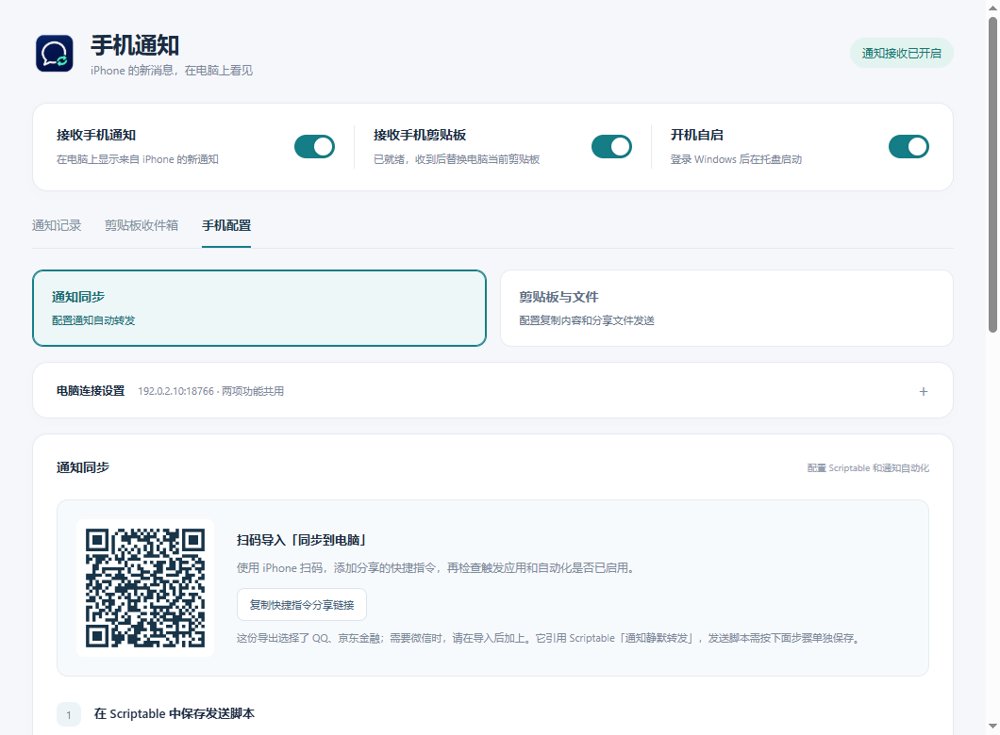

# 手机通知 · iPhone LAN Notify

通过局域网，把 iPhone 通知、剪贴板和分享文件发送到 Windows。无需蓝牙或 Phone Link，不使用云端中转。

电脑端是独立桌面应用，手机端使用快捷指令和 Scriptable。通知可以自动转发；剪贴板由用户触发一次发送。

**[下载 Windows 程序](https://github.com/xinyu68/iphone-lan-notify/actions/workflows/windows-build.yml)** · [安装与连接](#安装与连接) · [通知同步](#通知同步) · [剪贴板与文件](#剪贴板与文件) · [常见问题](#常见问题) · [开发说明](docs/DEVELOPMENT.md)



## 可以做什么

| 功能 | 手机端操作 | Windows 接收结果 |
| --- | --- | --- |
| 通知同步 | 收到所选 App 的新通知时自动转发 | 右下角紧凑卡片、通知中心、本机通知记录 |
| 文字与链接 | 复制后触发一次快捷指令 | 直接 Ctrl+V，保留换行和空格 |
| 单张图片 | 复制后触发快捷指令，或分享图像 | 可粘贴到支持图片的应用或资源管理器 |
| 文件与多张图片 | 从“文件”“照片”等 App 的分享菜单发送 | 保存到收件箱，可在资源管理器文件夹中 Ctrl+V |

- 通知卡片约 5 秒后收起，悬停时暂停，长消息省略显示。
- 点击卡片或通知中心消息，打开应用并定位、高亮对应记录。点击卡片还会清除通知中心对应消息，应用记录保留。
- 通知记录保留最近 **200 条、7 天以内**的内容。
- 内置 30 个中国常用 App 图标，其他应用按需查询 App Store 并缓存，无法确定时使用默认图标。
- 通知接收与剪贴板接收有独立开关；支持托盘运行和当前用户登录自启。

**使用边界：**通知自动化只转发文字，不提取通知中的图片、附件或按钮。剪贴板不会在每次复制后自动同步，不提供电脑到手机的反向同步；手机发送时无需常驻悬浮小窗。

## 使用前准备

| 项目 | 要求 |
| --- | --- |
| 电脑 | Windows 10/11 x64、Windows PowerShell 5.1、.NET Framework 4.6.2+（推荐 4.8）、WebView2 Runtime |
| 手机 | iPhone，安装快捷指令和 Scriptable，允许本地网络访问 |
| 通知同步的额外条件 | 快捷指令中能找到“收到某个 App 的通知”自动化触发器；只使用剪贴板功能不需要此触发器 |
| 网络 | 手机与电脑在实际可互通的局域网中，手机脚本使用电脑当前 IPv4 地址 |

完整发行包包含 Node.js，使用者无需单独安装。

同名 Wi-Fi 不一定互通；访客网络、AP 隔离、VPN 和虚拟网卡可能阻断连接。建议在路由器为电脑设置 **DHCP 地址保留**。本版本按 IP 配对，电脑地址变化后需要更新手机脚本。

Windows 10 19045 已有本机验证。Windows 11、其他显示缩放、企业策略和不同 iOS 环境仍需对应实机验证。通知触发器是否可用，以手机实际提供的选项为准，不承诺所有 iOS 版本均支持。

## 安装与连接

### 1. 下载完整程序包

打开 [Windows build](https://github.com/xinyu68/iphone-lan-notify/actions/workflows/windows-build.yml)，选择最近成功的构建，在 **Artifacts** 中下载 **PhoneNotify-win-x64**。

解压构建产物后取得程序 ZIP 和 SHA-256 校验文件，再解压程序 ZIP（例如 `PhoneNotify-1.2.0-win-x64.zip`）。请保留完整目录，不要只复制 EXE。

### 2. 检查环境并启动

在程序目录打开 PowerShell：

```powershell
powershell -NoProfile -ExecutionPolicy Bypass -File .\check-environment.ps1
```

缺少 WebView2 Runtime 时，从 [Microsoft 官方页面](https://developer.microsoft.com/microsoft-edge/webview2/) 安装，或运行：

```powershell
powershell -NoProfile -ExecutionPolicy Bypass -File .\check-environment.ps1 -InstallWebView2
```

脚本会校验下载程序的 Microsoft 数字签名。SDK DLL 本身不能代替 Runtime。

双击 `PhoneNotify.exe` 可直接使用；如需安装到当前用户目录并创建桌面快捷方式，运行：

```powershell
powershell -NoProfile -ExecutionPolicy Bypass -File .\install.ps1
```

默认安装位置为 `%LOCALAPPDATA%\PhoneNotify\app`。普通安装不需要管理员权限，防火墙配置另需管理员授权。

### 3. 配置局域网访问

1. 打开应用 **手机配置 → 电脑连接设置**，展开后选择与手机相通的网卡地址，保存地址和端口。通知同步与剪贴板共用此连接设置。
2. 点击 **允许局域网访问**，按提示完成 Windows 管理员授权。规则适用于 **公用、专用网络**，无需修改当前网络类型。
3. 按需开启 **接收手机通知** 或 **接收手机剪贴板**。首次安装默认关闭接收，每台电脑会生成独立配对令牌。
4. 使用通知功能时，先点击 **发送测试通知**检查电脑显示，再配置手机自动化。

防火墙规则只允许本地子网访问指定 Node.js 程序和 TCP 端口，在公用、专用网络中生效；此操作不会更改网络类型或防火墙总开关。

**开机自启表示当前用户登录 Windows 后启动**，不是未登录时运行的系统服务。关闭窗口会隐藏到托盘，托盘菜单可彻底退出。

## 通知同步

### 1. 保存 Scriptable 脚本

在电脑应用 **手机配置** 页点击 **通知同步**，复制或导出发送代码，传到 iPhone，在 Scriptable 中保存为 **通知静默转发**。

### 2. 导入或建立通知自动化

[打开“同步到电脑”快捷指令分享](https://www.icloud.com/shortcuts/f1cc45ac60934a4baa820400ed63fe2b)


导入后仍需确认通知触发器、来源 App 和引用脚本。分享模板不会代替当前电脑的配对脚本。链接失效时，可按下面步骤手动建立：

1. 新建“收到所选 App 通知时”的自动化，选择需要同步的应用。
2. 添加 **文本**动作，内容选择触发器的蓝色 **通知**变量。
3. 添加 **字典**，建立以下文本字段：

   | 字段 | 值 |
   | --- | --- |
   | `message` | 前一个“文本”动作的输出 |
   | `appId` | 触发器“通知”变量的 **App** 属性 |

   系统能提供 Bundle ID 时可以传入，只能提供应用名称也可以。字段值应选择变量，不要手动输入“通知”两个字。

4. 添加 Scriptable **运行脚本**，选择 **通知静默转发**，参数选择上一步 **字典**。
5. 关闭 **在 App 中运行** 和 **运行时显示 / Show When Run**。按系统提供的选项允许无需确认、锁定时运行，并允许本地网络访问。

### 3. 验证自动转发

用一条 **新收到的真实通知**测试，再锁屏测试。手动点击运行通常没有通知触发器输入，不能作为实际转发失败的依据。

建议验证三种状态：连着局域网时能收到；关闭手机 Wi-Fi 时不弹请求超时；重连后新的通知恢复接收。离线通知静默跳过，不补发历史消息。

## 剪贴板与文件

先在电脑应用开启 **接收手机剪贴板**。此开关独立于通知接收，两项都关闭时停止接收服务。

### 1. 保存 Scriptable 脚本

在电脑应用 **手机配置** 页点击 **剪贴板与文件**，复制或导出发送代码，传到 iPhone，在 Scriptable 中保存为 **发送到电脑**。顶部两栏可直接切换配置。**剪贴板收件箱** 页只展示接收记录和文件入口，也可从该页的“手机发送配置”按钮直接打开剪贴板配置。

| 功能 | Scriptable 脚本名称 |
| --- | --- |
| 自动转发通知 | 通知静默转发 |
| 手动发送剪贴板或文件 | 发送到电脑 |

### 2. 扫码导入快捷指令

[打开“发送剪切板到电脑”快捷指令](https://www.icloud.com/shortcuts/154c82177e5a45c295d1c8419607f8ed)


**二维码只导入快捷指令动作，Scriptable 脚本仍需按上一步单独保存。** 链接失效时，可手动建立相同的两个动作：

| 顺序 | 动作 | 配置 |
| --- | --- | --- |
| 1 | 获取剪贴板 | 读取手机刚复制的内容 |
| 2 | Scriptable：运行脚本 | 选择 **发送到电脑**，参数选择上一步蓝色的 **剪贴板**变量 |

展开“运行脚本”选项，**关闭“在 App 中运行”和“运行时显示 / Show When Run”两个开关**。不要将“剪贴板”三个字作为普通文字输入，也不要留空参数；由快捷指令读取内容后传给脚本。

首次按提示允许剪贴板和本地网络访问。将快捷指令添加到 **控制中心**，或绑定 **设置 → 辅助功能 → 触控 → 轻点背面**。手机复制文字或图片后触发一次，电脑即可按 Ctrl+V。

### 3. 从分享菜单发送文件

在 Scriptable 脚本设置的 **Share Sheet Inputs** 中勾选四项：

| 选项 | 内容 |
| --- | --- |
| Text | 文字 |
| Images | 图像 |
| URLs | 网页链接 |
| File URLs | 本机文件 |

在 iPhone“文件”“照片”等 App 中选中内容，点 **分享 → Scriptable 的运行脚本 → 发送到电脑**，具体入口名称以实际界面为准。文件请使用分享菜单发送，文件夹请先压缩。

单张图像输入转换为 PNG，电脑同时获得位图、PNG 和文件列表格式；多张图像作为文件接收。分享的文件保留原始字节。收件箱记录可显示 PNG/JPEG 小图预览，每条最多四张，点击可放大查看；图片已删除或无法解码时显示提示，仍保留文件位置入口。预览从本机文件读取，关闭接收后也能查看。目标应用能否接受图片或文件粘贴，取决于该应用对剪贴板格式的支持。

<details>
<summary>查看剪贴板收件箱界面</summary>


</details>

### 大小限制与保存方式

| 项目 | 上限或行为 |
| --- | --- |
| 纯文字 | 1 MiB，正文在本机接收记录中保存，保留换行，长内容可展开查看 |
| 单个文件 | 50 MiB |
| 单次发送 | 最多 20 个文件，合计 100 MiB |
| 本机收件箱 | 1 GiB，达到后需清理才能继续接收文件 |
| 接收记录 | 最近 50 次，保存文字正文、时间、类型和文件名；超出后清理旧文字记录 |

收到内容会 **替换 Windows 当前剪贴板**。图片和文件保存在收件箱，直到用户自行删除；应用中可以打开接收文件夹或对应文件位置。

较大文件或图像可能触及 iOS 扩展内存限制，被系统中止时可开启“在 App 中运行”重试，此时会进入 Scriptable。手动发送失败会显示失败通知；通知自动转发失败则静默跳过。

## 常见问题

| 问题 | 处理方法 |
| --- | --- |
| 手机发送后电脑没有反应 | 确认手机实际连上 Wi-Fi、局域网互通、对应接收开关已开启；检查网卡、脚本 IP/端口/令牌、防火墙规则和路由器隔离。电脑“发送测试通知”只验证本机显示，手机连接仍需单独测试 |
| 复制文字后提示没有可发送内容 | 先“获取剪贴板”，将结果以蓝色变量传给“运行脚本”的参数；参数留空时，部分 Scriptable 运行环境无法直接读到内容 |
| 复制图片后传入 `file://…png` 地址 | 快捷指令可能将图片参数转为手机临时文件 URL。新版“发送到电脑”脚本会读取文件字节发送，单张 PNG/JPEG 按图片接收；若电脑只收到地址文字，请从电脑应用重新复制脚本，替换手机 Scriptable 中的“发送到电脑”。无需改成分享菜单流程；仍受 iOS 临时文件访问权限影响 |
| 执行后弹窗一直不消失 | 关闭“运行时显示 / Show When Run”，同时保持“在 App 中运行”关闭；从控制中心等实际入口测试，编辑器内可能显示结果预览 |
| 电脑换 IP 或换新电脑 | 保存正确网卡地址，重新生成手机对应的 Scriptable 脚本；快捷指令动作可复用，每台电脑的地址和令牌单独配置 |
| 重连后没有补发旧通知 | 离线通知会跳过，重连后只同步新的通知；剪贴板没有离线发送队列，需要手动重发 |
| 界面加载失败 | 运行 `check-environment.ps1`，确认已安装 WebView2 Runtime |
| 通知中心没有记录或点击不生效 | 检查 Windows 通知设置、勿扰设置，以及是否通过完整桌面应用启动；新电脑应实际点击一次系统通知验证定位 |
| 未知 App 显示默认图标 | 可能没有唯一匹配或网络超时，不影响通知内容；已有缓存可以离线使用 |

<details>
<summary>App 图标如何匹配</summary>

优先匹配精确 Bundle ID，其次使用内置名称和明确别名。目录外的应用在线查询后，只接受唯一完整名称，或去掉 `-`、括号、冒号等宣传后缀后的唯一基础名称，不直接采用搜索第一项，也不会按“包含 QQ”把 QQ邮箱识别成 QQ。

已有图标立即显示，过期后后台更新；未知应用最多等待图标约 2.2 秒，超时先用默认图标。内置 30 个应用的清单见 [App 图标目录](app-icon-catalog.json)。图标查询只发送应用名称或商店 ID，不发送通知正文。

</details>

## 数据与升级

新安装默认数据目录：`%LOCALAPPDATA%\PhoneNotify\data`，程序与用户数据分开保存。

| 文件或目录 | 用途 |
| --- | --- |
| `config.json` | 监听 IPv4、端口、独立令牌和运行时位置 |
| `preferences.json` | 通知及剪贴板接收开关偏好 |
| `.notification-history.json` | 本机通知文字记录 |
| `.icon-cache` | App 图标与商店元数据 |
| `inbox` | 接收的图片与文件，由用户自行清理 |
| `clipboard-receipts.json` | 最近 50 次接收记录，包含文字正文或长文字预览 |
| `clipboard-text` | 长文字全文，按需读取；随接收记录淘汰自动清理 |
| `.incoming` | 未完成上传暂存，过期或下次启动时清理 |
| `.webview2-profile` | 桌面界面的 WebView2 数据 |
| `runtime.json`、`controller-state.json`、`receiver.log` | 服务状态与日志 |

- **升级：**解压新发行包，重新运行其中的 `install.ps1`，保留用户数据目录。
- **便携版：**程序根目录已有 `config.json` 时继续使用该目录及原令牌。移动目录后，需重新配置启动项和快捷方式；也可通过绝对路径环境变量 `PHONE_NOTIFY_DATA_DIR` 指定独立数据目录。
- **卸载：**运行 `uninstall.ps1`，移除本安装拥有的桌面入口、自启与激活注册；用户记录和配对信息保留，退出后可自行删除程序目录。
- **移除防火墙规则：**管理员运行 `configure-firewall.ps1 -NodePath <完整node.exe路径> -Port 18766 -Remove`，端口以实际配置为准。

接口使用带随机令牌的本地 HTTP 地址，不提供 TLS 加密，请仅在可信局域网使用，不做公网端口映射或转发。

个人生成的 Scriptable 脚本、带令牌的配对地址和配对二维码属于访问凭据，请勿公开上传。本文的快捷指令导入二维码是公开分享链接，不含本机配对信息。

## 从源码构建

需要 Windows x64、Node.js 20+（推荐 22/24）、Windows PowerShell 5.1 和 .NET Framework 4.6.2+，无需 `npm install`。

```powershell
git clone https://github.com/xinyu68/iphone-lan-notify.git
cd iphone-lan-notify
npm test
powershell -NoProfile -ExecutionPolicy Bypass -File .\build-app.ps1
powershell -NoProfile -ExecutionPolicy Bypass -File .\build-release.ps1 -SkipBuild
```

构建自动下载固定版本的 WebView2 SDK；完整打包时下载 `node-runtime.json` 指定的官方 Node.js，并校验 SHA-256。输出在 `dist`，包含完整文件清单和 ZIP 校验文件。输出目录已存在时，应先移走旧产物再打包。

源码不提交个人配置、运行记录、运行时或 EXE。测试范围、桌面集成检查和 API 示例见 [开发说明](docs/DEVELOPMENT.md)。

## 许可

本项目采用 [MIT](LICENSE)。第三方组件、App 图标及商标见 [第三方声明](THIRD_PARTY_NOTICES.md)。
